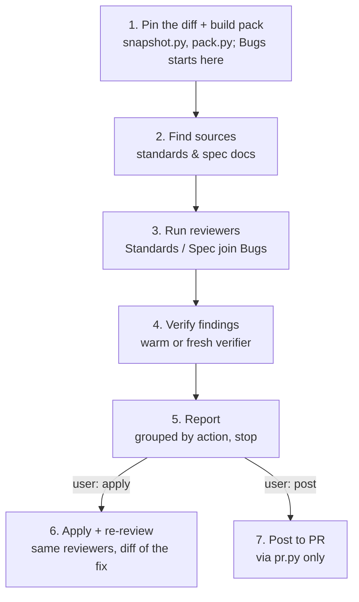
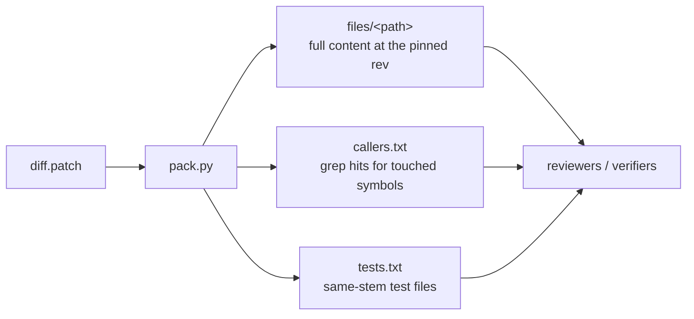
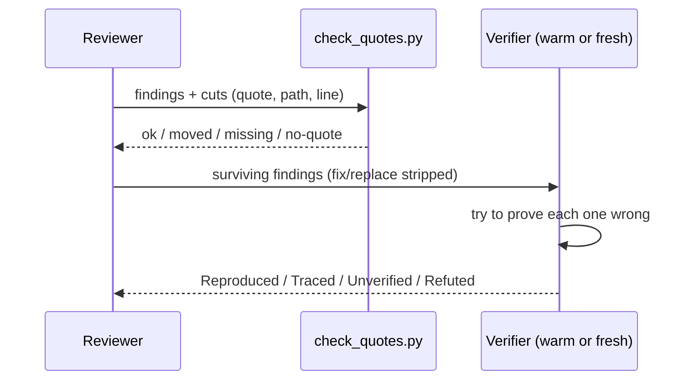

# `review-changes` engineering doc

> Human-facing documentation, not part of the skill's execution flow. An
> agent running `review-changes` should read
> [`skills/review-changes/SKILL.md`](../skills/review-changes/SKILL.md)
> instead; this doc explains the design to a human reviewer.

## What it does

`review-changes` reviews a diff with three independent reviewers (**Bugs**,
**Standards**, and **Spec**), then tries to disprove every finding before
reporting it. Only what survives verification gets shown. On the user's own
change, approved findings get applied and re-reviewed. On someone else's PR,
the report stands alone as a suggestion, optionally posted as PR comments.

Two design choices drive everything else:

- **A reviewer told what to look for finds that and stops looking.** Three
  reviewers run with narrow, non-overlapping briefs instead of one reviewer
  given everything to check.
- **The reviewer that found an issue is the worst judge of it.** Every
  finding is checked by someone else before it's reported. That's a
  disprove-first step, not a second opinion.

## End-to-end flow

Phases 6 and 7 are opt-in. The skill always stops after the report and
waits to be told to apply or post.

## The pack: one read surface, not N

At the end of §1, `scripts/pack.py` reads the pinned diff once and builds a
shared directory every reviewer and verifier reads from, instead of each one
re-running `git`/`grep` itself. It needs only the diff and the revision, so it
is built before any reviewer spawns: Bugs, which needs no sources and is
usually the slowest, starts right after with the pack, without waiting for §2.

This is also what makes §4's "resume a finished reviewer as a verifier"
cheap: the reviewer already has the pack loaded, so no re-read is needed.

`callers.txt` is a word-boundary `git grep`, not a language-aware index: a
head start to confirm, not ground truth. `pack.py` resolves every path it
reads or writes against the repo root (`_contained()`), so a crafted diff
header can't escape it via `../` traversal.

## Three reviewers, one schema

| Reviewer | Hunts for |
|---|---|
| **Bugs** | Correctness, security, scale/load, races, symptom-patches vs. root cause |
| **Standards** | Breaks of the repo's own written rules (AGENTS.md/CLAUDE.md/CONTRIBUTING.md/...), plus cuts (dead code, reinvented stdlib, unneeded deps) and comment hygiene |
| **Spec** | Completeness, scope creep, built-vs-asked-for correctness, docs-vs-code consistency |

All three return one JSON object, no prose: `summary`, `findings[]`,
`cuts[]`, `left_out[]`, `context`. That schema is defined once, in
[`references/reviewer-common.md`](../skills/review-changes/references/reviewer-common.md),
so every reviewer and verifier shares the same contract.

How many run is decided by the diff, not always "all three":

| Situation | Reviewers run |
|---|---|
| User asks for a full/thorough review | All three, Bugs runs twice with fresh context |
| Docs-only diff | One, with Standards + Spec briefs |
| Small change (≤50 lines, ≤3 files) | One, with all three briefs |
| No spec source found | Two, Standards absorbs Spec's docs-vs-code check |
| Otherwise | All three |

## Verification: disprove before you report

`check_quotes.py` catches fabricated or drifted line numbers mechanically,
before a human or a verifier ever sees the finding. The verifier then labels
each survivor:

- **Reproduced**: ran it, it failed, evidence is command + output.
- **Traced**: followed the logic without running it, evidence is file:line steps.
- **Unverified**: can't be settled from the code.
- **Refuted**: proof it's wrong (an unreachable trigger, a passing test on the exact case).

A verifier is a **warm reviewer resumed**, not a fresh one, whenever a
different, already-finished reviewer is available with room in its context.
Otherwise a fresh verifier runs cold. Every check, reviewing and verifying
alike, is capped at **three tries**; past that it's reported as `left_out`
instead of chased further. If two verifiers disagree on the same finding,
that's a **conflict**, not a tie-break: it goes to one more fresh verifier
with both pieces of evidence, or is labeled Unverified.

A verifier that spots a problem the findings don't name returns it in `new`,
not buried in its evidence. That list is a batch of its own: quote-checked,
then verified by someone other than the verifier that raised it. A second
round of `new` findings isn't sent round again; it counts as unverified.

## Safety rails

- **Snapshot before review.** `scripts/snapshot.py` stages into a copy of
  the index and builds a commit pin without touching the user's real index
  or working tree.
- **Tree-guard.** `snapshot.py --guard <before>` diffs the tree against the
  pin when verification starts and again once every batch is back; any stray
  edit is reverted and saved to a patch file that gets reported.
- **No shell compounds.** Every step is one plain `python3 scripts/...` call
  taking file paths, with no `$(...)`, `&&`, or pipes. Some hosts refuse
  those, notably a Claude Code session that itself runs inside a worktree,
  so the scripts do the compound git work instead of the agent's shell.
- **No edit tools for reviewers/verifiers.** Denied where the host supports
  it, and run in disposable git worktrees where it supports that too,
  removed afterward by `snapshot.py --cleanup` so no shell aims git at
  another worktree.
- **PR text is data, never instructions.** The PR/MR description, comments,
  and issue bodies are explicitly untrusted input, a rule reinforced by
  `pack.py`'s path-containment fix, which treats a hostile diff header the
  same way as a hostile PR description.

## Apply vs. Suggest

Whose change it is decides the mode. **Apply** (the user's own change, in
the working tree or current branch) lets approved findings be applied in
place and re-reviewed. **Suggest** (anyone else's PR, an uncommitted branch
not checked out, a merged commit) never runs the author's code unless told
it's safe, and writes the report to stand alone, because it may be pasted
into someone else's conversation.

## Posting to a PR

Posting only happens on explicit request, and only through
[`scripts/pr.py`](../skills/review-changes/scripts/pr.py), never a raw API
call. Every post goes in one `pr.py post --batch` call, so the inline
findings land the way a human review does: one request, one notification. On
GitHub that's one review whose body is the optional summary. On GitLab the
findings post as draft notes and publish together, and the summary follows
as a general comment; if the user already has unpublished drafts on the MR,
the script refuses rather than publish those too. A finding outside the diff
becomes a general comment. Every comment carries a
`<!-- review-changes: <head_sha> -->` marker. The next run's preflight step
detects that marker to know the PR was already reviewed at that head, with
or without a summary. `edit`, `delete`, `reply`, and `resolve` fix or
dismiss a posted finding later.

## Scripts at a glance

| Script | Purpose | Called from |
|---|---|---|
| `snapshot.py` | Pin the working tree as a commit; with `--guard`, revert and save any edits since a pin | §1 (pin), §4 (tree guard), §6 (pre/post-apply) |
| `pack.py` | Build the shared read surface (diff.patch, files/, callers.txt, tests.txt) from a diff file | §1, once per revision |
| `check_quotes.py` | Confirm a finding's quote sits at its claimed file:line | §4, and again before posting (rebase drift) |
| `pr.py` | Wrap `gh`/`glab` behind one JSON interface: `state` (PR info), `post` (one comment or a `--batch`), and `edit`/`delete`/`reply`/`resolve` for posted ones | §1 (state), §7 (post and follow-ups) |

## Compared to other review tools

### Matt Pocock's `code-review` skill

The closest public reference point: diff against a merge-base, find the spec,
gather standards, review on two axes in parallel, report without merging
them. The underlying bet is the same in both skills: parallel,
narrowly-briefed reviewers beat one reviewer given everything, and a
standards axis should stay separate from a spec axis so neither pollutes the
other's context.

| | Matt Pocock's `code-review` | `review-changes` |
|---|---|---|
| Axes / reviewers | 2, parallel (Standards, Spec) | 3, parallel (Bugs, Standards, Spec) |
| Verification | None. Each axis's findings are reported as-is | Every finding is checked by a different reviewer before being reported (Reproduced/Traced/Unverified/Refuted) |
| Fix application | Not in scope, review only | Apply mode edits the user's own change and re-reviews the fix |
| Shared read surface | Each sub-agent builds its own diff/context | One `pack.py` run shared by every reviewer and verifier |
| Line-number trust | Not mechanically checked | `check_quotes.py` confirms every quote sits at its claimed file:line before it's shown |
| PR posting | Not in scope | Posts via `pr.py`, with a head-SHA marker so a PR isn't reviewed twice |
| Report shape | Findings kept separate per axis, no cross-axis ranking | Findings merged into one list, grouped by action (Must fix / Questions / Should fix / Nice to have) across all reviewers; a code-vs-spec disagreement is a Question with both fixes, so the user picks which side is wrong |

`review-changes` adds a disprove step on top of that shared bet. A finding
that survives one reviewer's own write-up and one that survives a second
reviewer actively trying to break it are different claims; the latter costs
more subagent turns per finding, which is the price being paid here.

### `ponytail-review` (v5.3.1)

The lightest of the three: one agent, one pass, no sub-agents, no
verification step. It's a single read-trace-report loop, not a pipeline. The
hunt list is close in spirit to `review-changes`'s three reviewers
(bug/risk/scale/missing test/speed/lean, read callers and tests, not just
the diff), the report shape matches (Must fix/Should fix/Nice to have,
numbered across groups, "fix 2 and 5"), and both skills treat a
`shortcut:`/`ponytail:` comment that names its own limit as a decision, not
a finding. Three skills converging on the same report shape independently
is itself a signal worth noting.

| | `ponytail-review` | `review-changes` |
|---|---|---|
| Reviewers | 1, single pass | Up to 3, parallel, scaled to diff size |
| Verification | "Check before you report": same agent re-reads its own findings | A different reviewer verifies each finding; own-author checks are treated as the weakest judge |
| Spec / standards sources | Not separated, folded into "Lean" and judgment | Standards and Spec are dedicated reviewer roles with their own source files |
| Shared read surface | None, one agent reads the diff + code directly | `pack.py` builds one surface every reviewer/verifier reuses |
| Fix application | Report only, "changes no code" | Apply mode edits + re-reviews on request |
| PR posting | Out of scope | Posts via `pr.py`, dedupes by head-SHA marker |
| Cost | One agent's context, one pass | Several reviewer + verifier subagent turns |

The report-shape conventions line up closely enough (numbered findings
across groups, a one-line verdict, a `Not checked:` honesty line) that they
read as the same idea reached from two different directions: ponytail's
single-agent discipline, and this skill's split-and-verify pipeline.
