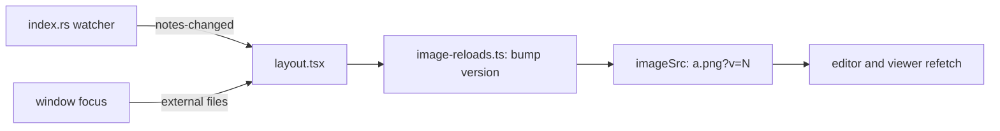

# Example bodies

Each shows how a change shapes its body. None is a form to fill: a body needs only the parts its change calls for, and the rules are in SKILL.md under Voice.

## A small fix

One file. Once the cause is known the fix is the diff, so the body is a Why alone.

````markdown
### Why

An xy chart drew its series in the library's default inks, not the app's. The chart carries a second `<style>` block for them, and the content security policy drops any block without the nonce, but `mermaid-diagram.tsx` stamped only the first.
````

## A refactor

No behavior should change, and that is the reviewer's question, so Approach says so and names the test that shows it. Nothing specific to check, so no Review.

````markdown
### Why

Closes #261

Every mounted note added its own window `blur` listener, so one blur with ten tabs open ran ten listeners. `NoteSession` says window listeners belong to the workspace, and this was the only one that broke the rule.

### Approach

One `blur` listener in `layout.tsx` now calls `flushPendingWrites()`, which quit and the updater already use. `useAutosave` keeps registering its flush there and drops its own listener.

Behavior is unchanged: a blur still saves every tab with pending edits. A new `layout.spec.tsx` test types in two tabs and blurs before either 800ms debounce runs; both notes save.
````

## A generated change

69 files, most of them a lint rule's autofix. Approach says what made the rewrites and what was written by hand, and why the ready-made plugins lost. Review says where to spot-check.

````markdown
### Why

Closes #536

AGENTS.md says a file imports from its own folder with `./` and from anywhere else under `src` with `@/`, never `../`. No lint rule enforced either half, so 91 same-folder `@/` imports built up, and six specs reached `fixtures/` with `../../`.

### Approach

Most of the 69 files are the rule's own autofix (`pnpm fix`); the hand-written part is `oxlint.config.ts` and `tsconfig.json`.

- Same folder: one `no-restricted-imports` override per folder under `src`, listed with `globSync` so a new folder is covered. It flagged exactly the 91 sites.
- Parent: `import/no-relative-parent-imports`, off in the Ultracite preset, is on for `src/**` only.
- Fixtures: specs reach them through a new `@fixtures/*` path, since the Rust crates keep them at the root.

Rejected `@uphold/eslint-plugin-import-direction` and `eslint-plugin-relative-imports-when-same-folder`: both make a whole subtree relative, which would have turned 78 child-folder imports into `./a/b`.

### Review

Design check on one override per folder against a local rule. To spot-check the autofix, `src/data` holds 22 of the 69 files.
````

## A flow across components

A watcher event now reaches the editor through three modules, and a failing test pins the bug. The flow gets a diagram with one sentence before it, the failing test sits under Approach, and Review asks for one design check and names what no test reaches.

````markdown
### Why

Closes #483

An image kept whatever it first loaded. A file replaced on disk never reached a plain `` until the note reopened, and an image beside an external file never refreshed at all.

### Approach

The webview serves a loaded URL from its cache, and the asset protocol reads only the path, so a changed file needs a new URL. A watcher report now bumps a version that `imageSrc` appends as `?v=N`:



External files have no watcher, so focus stands in for it. A report with no paths, as after a reindex, reloads every open image.

Two fixes rode along: a resize released at the stored width spends no undo, and `layout.tsx` tests watcher paths with `isNoteFile`, since `isNotePath` cut at `#` and read `pics.md#1/c.png` as a note.

With main's source and this branch's tests, 8 layout tests fail:

```console
pnpm vitest run src/layout.spec.tsx -t "load an image again when a change names"
AssertionError: expected [] to strictly equal [ 'plain a', 'a.png' ]
```

### Review

Design check on the `?v=N` cache bust; the rest follows from it. Whether WebKit keeps the old picture painted until the new file decodes is the one behavior no test here reaches.
````
