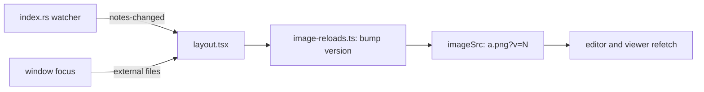

# Voice

Read at §4, before the first draft. Section numbers (§1, §3, §5) and Principle point to SKILL.md.

## Contents

- Default shape
- Why, Approach, Evidence, Review
- With a template
- Examples

Applies to the body. The title follows the shape from §1 exactly, emoji and all.

**Default shape** (no template). Three `###` headings, Why, Approach, Review, in that order, always headings and never bold run-in labels. A heading exists only when it has something under it. Inside a section use whatever tells the story: a list for same-shaped items, a table for a series of pairs or for same-shaped cases with different outcomes, a ```` ```console ```` fence for a command or its output, a file tree or two-column table for a structure that changed, a Mermaid flowchart or sequence diagram for a flow, call path, or state machine across more than two components, `### Before` / `### After` for screens. Prose is the default; a block earns its place by being clearer than the sentence it replaces, and it replaces that sentence rather than sitting beside it.

A diagram draws the real mechanism (the files, calls, events, and states in the diff), not a picture of the domain, in a `mermaid` fence after one sentence that says what it shows; screen readers get nothing from the drawing. Keep it small, skip `alt`/`else` unless the branch is the point, and don't walk its edges again in prose. A change with one or two moving parts gets no diagram. A file tree is the one plain-text drawing: arrows or boxes in a plain fence are a lint error.

```markdown
### Why

<ticket reference, alone, if there is one>

<The problem: what was wrong, how it showed up, why now.>

### Approach

<The decisions the diff does not show.>

<Evidence, where a real before and after exists.>

### Review

<What the reviewer should do with this.>
```

Why is required and first. Approach and Review exist only when they have content; a dependency bump is often a Why and one Approach line on breaking changes. No other section names, nothing follows Review except the attribution footer from Principle. The first sentence of each section carries the point.

**Why** answers "what was wrong and why it mattered," never "what changed": that is Approach's job. Readable without opening the ticket; short sentences, concrete nouns, no "This PR introduces". Asked for more detail, say more about the problem (where it leads, how it showed up, why now), not about the changes.

**Approach** holds only what a reviewer cannot tell from the diff or the file list: the alternative rejected and why, a departure from the codebase's usual pattern, what is deliberately out of scope, the one behavior change inside a refactor, a default that flipped, a change the ticket didn't ask for and why it rode along, a gate weakened (a test skipped or deleted, a threshold lowered, a workflow or lint rule changed) and why, the command or tool behind a generated change (a codemod, a bump, a formatter run) and any hand edits on top, and how to undo the change when a plain revert won't (a migration, a data change, a flag to flip). Name the file, symbol, package, or flag ("the 320px cap is gone", not "updated the component"). A refactor says behavior is unchanged and what shows it (the test that covers it), or names the one change; reviewers take a bare "no behavior change" from an agent far less often than from a person. A dependency bump names its breaking change, or says the changelog lists none. How it works is in the diff, unless the code is hard to follow: then a sentence or two on the tricky part (the invariant it keeps, the order that matters, why it runs twice) saves the reviewer rebuilding it. A migration that just adds a column gets no mention unless something in it is surprising. An approach that fits in two sentences gets two sentences. A list is for same-shaped items only, one or two short clauses per bullet, at most one semicolon; a sub-list only when each item has its own change (one child per package in a toolchain upgrade, one per change in a file with several). Items sharing one change get a group name on one bullet ("Docs: spec, design, README"); two items stay inline. The file inventory, one bullet per touched file, is the failure this shape exists to prevent; the §5 lint warns at 4 or more bullets that each lead with a file path.

```markdown
- `image-resize.ts`:
  - drag a handle on the right edge to resize; only `width` is saved
  - pointer capture stops `DragSelectionView` from also selecting the node
```

**Evidence** is what a reviewer can't get elsewhere, a real before and after or, for a feature, the after alone: a number, a screenshot, a test that failed and now passes. "Tests pass" is not evidence; the PR shows CI. §3 says what each kind of change gets. It sits right after the sentence it supports: `### Before` / `### After` for screens, a ```` ```console ```` block under Approach for a test or command output, a timing as a number in the sentence or a table for several.

**Review** is the one paragraph written to the reviewer, and only from what the user or the session actually said; an invented doubt sends them to the wrong place. A specific feedback request is the single element of a description with the strongest measured effect on review, so write one whenever the user or session gave anything to ask. Its content: the feedback wanted ("design check on the cache key, the rest is mechanical"), where to start in a large diff, which files to spot-check in a generated one, what the author is unsure of, and a behavior left unverified that a reviewer would assume was covered. Say the behavior, not the step skipped: "the retry path never ran against the real API" is actionable; "`pnpm dev` was not run" is not, and a reviewer once said so. Clicking through `pnpm dev` or a staging deploy proves nothing a reviewer can rerun. If a behavior is worth checking, a test checks it: write the test before §5. Review names only what no test here can reach (a real third-party API, production data), as the behavior. The §5 lint flags "not run in dev" wording. Mechanical files (renames, formatter output) go as self-comments on the diff. Coordination talk ("Deploy order", "This merges first", "Follow-up MR") stays in the chat summary: the body is about the change, not the session.

A risk gets one clause in the Approach sentence it belongs to, only when the reviewer has something specific to check. Don't attribute to a role you can't verify ("reviewer flagged", "per discussion") unless a named reviewer said it in the thread. Same for a referenced PR, ticket, or incident: fetch it and confirm before saying what it did or broke; unverified, state only what's known ("spooked the team", not "broke builds").

Every file the body names must be in the diff, and a claimed test must have a test file behind it; describing work the diff does not contain is what most reliably gets a PR rejected.

What the change holds decides what the body says, not its size. Description length does not predict whether a PR merges; what it says does. Hard-to-follow code gets its tricky part explained, a large diff gets where to start, a generated change gets the command that made it.

No em dashes, en dashes, middle dots, curly quotes, sign-offs, or emoji; the attribution footer from Principle is the one exception, added after the lint. No summary of the summary. No self-grading ("robust", "comprehensive", "properly"). No hedges once a fact is settled. No assertion standing in for evidence ("tests pass", "tested locally", "fully backward compatible"). The §5 lint enforces this section. In the chat turn around the draft, no chatty opener ("Great, let's...") or closing pleasantry ("Let me know if you need anything else!"); start with the content and end with the thing itself or its next-action line.

**With a template**, its headings and order win. Fill each section in this voice: Why's rules where it asks for motivation, Approach's where it asks for the changes. Handle unused sections the way recent merged PRs do; when they don't settle it, delete a section with nothing to say rather than writing "N/A". Remove the template's instruction comments; keep a comment that recent merged PRs still carry (a bot or check reads it). An AI disclosure field gets the tool and the extent, truthfully.

## Examples

Each shows how a change shapes its body. None is a form to fill: a body needs only the parts its change calls for, and the rules above still apply.

### A small fix

One file. Once the cause is known the fix is the diff, so the body is a Why alone.

````markdown
### Why

An xy chart drew its series in the library's default inks, not the app's. The chart carries a second `<style>` block for them, and the content security policy drops any block without the nonce, but `mermaid-diagram.tsx` stamped only the first.
````

### A refactor

No behavior should change, and that is the reviewer's question, so Approach says so and names the test that shows it. Nothing specific to check, so no Review.

````markdown
### Why

Closes #261

Every mounted note added its own window `blur` listener, so one blur with ten tabs open ran ten listeners. `NoteSession` says window listeners belong to the workspace, and this was the only one that broke the rule.

### Approach

One `blur` listener in `layout.tsx` now calls `flushPendingWrites()`, which quit and the updater already use. `useAutosave` keeps registering its flush there and drops its own listener.

Behavior is unchanged: a blur still saves every tab with pending edits. A new `layout.spec.tsx` test types in two tabs and blurs before either 800ms debounce runs; both notes save.
````

### A generated change

69 files, most of them a lint rule's autofix. Approach says what made the rewrites and what was written by hand, and why the ready-made plugins lost. Review says where to spot-check.

````markdown
### Why

Closes #536

AGENTS.md says a file imports from its own folder with `./` and from anywhere else under `src` with `@/`, never `../`. No lint rule enforced either half, so 91 same-folder `@/` imports built up, and six specs reached `fixtures/` with `../../`.

### Approach

Most of the 69 files are the rule's own autofix (`pnpm fix`); the hand-written part is `oxlint.config.ts` and `tsconfig.json`.

- Same folder: one `no-restricted-imports` override per folder under `src`, listed with `globSync` so a new folder is covered. It flagged exactly the 91 sites.
- Parent: `import/no-relative-parent-imports`, off in the Ultracite preset, is on for `src/**` only.
- Fixtures: specs reach them through a new `@fixtures/*` path, since the Rust crates keep them at the root.

Rejected `@uphold/eslint-plugin-import-direction` and `eslint-plugin-relative-imports-when-same-folder`: both make a whole subtree relative, which would have turned 78 child-folder imports into `./a/b`.

### Review

Design check on one override per folder against a local rule. To spot-check the autofix, `src/data` holds 22 of the 69 files.
````

### A flow across components

A watcher event now reaches the editor through three modules, and a failing test pins the bug. The flow gets a diagram with one sentence before it, the failing test sits under Approach, and Review asks for one design check and names what no test reaches.

````markdown
### Why

Closes #483

An image kept whatever it first loaded. A file replaced on disk never reached a plain `` until the note reopened, and an image beside an external file never refreshed at all.

### Approach

The webview serves a loaded URL from its cache, and the asset protocol reads only the path, so a changed file needs a new URL. A watcher report now bumps a version that `imageSrc` appends as `?v=N`:



External files have no watcher, so focus stands in for it. A report with no paths, as after a reindex, reloads every open image.

Two fixes rode along: a resize released at the stored width spends no undo, and `layout.tsx` tests watcher paths with `isNoteFile`, since `isNotePath` cut at `#` and read `pics.md#1/c.png` as a note.

With main's source and this branch's tests, 8 layout tests fail:

```console
pnpm vitest run src/layout.spec.tsx -t "load an image again when a change names"
AssertionError: expected [] to strictly equal [ 'plain a', 'a.png' ]
```

### Review

Design check on the `?v=N` cache bust; the rest follows from it. Whether WebKit keeps the old picture painted until the new file decodes is the one behavior no test here reaches.
````
